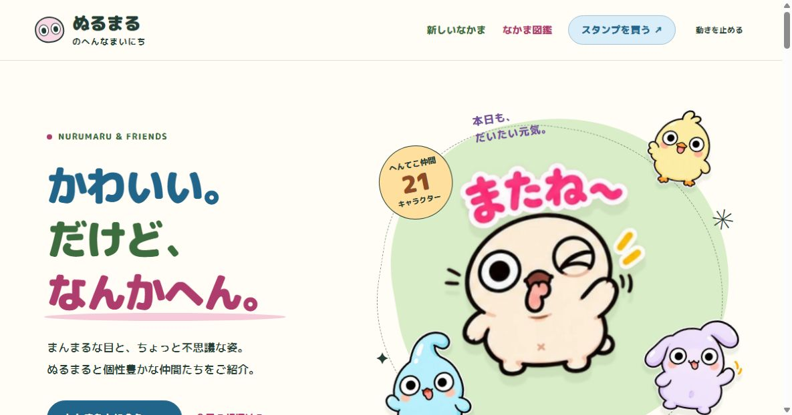

# ぬるまるのへんなまいにち

ぬるまるシリーズのキャラクター紹介サイト。GitHub Pagesで公開する、外部ライブラリ不要の静的サイトです。

[ホームページを見る](https://apuriyacom-ui.github.io/nurumaru-world/) · [LINE STORE](https://store.line.me/stickershop/author/6720739/ja)



更新日：2026年10月26日。全53体を掲載。新しい16体の紹介・全256枚のスタンプ見本と、販売開始済み4作品の購入リンクを追加しました。

## 内容

- 53キャラクターの紹介、検索、性格別フィルター、お気に入り
- 各キャラクターの16枚のスタンプ一覧
- 最新4キャラクターの紹介コーナー
- LINE STOREの各作品へのリンク（公開が確認できた作品のみ）
- スマートフォン表示、キーボード操作、動きを控える設定に対応
- ポップな丸文字・大きな説明文・色分けした見出し（Zen Maru GothicをGoogle Fontsから読み込み）

## キャラクターを追加する

図鑑は `data/characters.json` で管理します。1,000体までを想定し、一覧は12体ずつ表示します。未作成のキャラクターを空のカードで水増しすることはありません。

1. `assets/characters/<新しい英数字ID>/` に `main.webp` と `01.webp`〜`16.webp` を追加します。元のPNGを配置する場合は、下記の変換を行います。
2. `data/character-template.json` を参考に、`data/characters.json` の配列末尾へ1体分を追加します。
3. `id` と `number` を既存のキャラクターと重複させないでください。番号は一度決めたら維持します。
4. `temperament` は `おっとり`・`にぎやか`・`ふしぎ` のいずれか。`traits` は検索にも使う短い特徴です。
5. `stickers` の16項目へ実際のファイルとセリフを記入します。キャラの見た目を変えずに画像を用意してください。
6. 公開された作品の実際のLINE STORE URLを `storeUrl` に設定します。管理画面のスタンプIDと販売用のIDは異なる場合があります。未公開なら `null` のままにします。
7. 元のPNGから変換する場合は、Pillowを用意して `python scripts/optimize-images.py` を実行します。高品質WebP（品質92、透過維持）を作り、JSONの参照も更新します。PNGは手元に保存され、公開対象には含めません。`--lossless` を付けると画素を維持しますが、容量が増えます。
8. `node scripts/validate.mjs` でチェックし、GitHubへ反映します。

登録数・図鑑・検索はデータから更新されます。最新の仲間として紹介する作品は `releasedAsNew: true` を設定してください（図鑑番号の新しい順に最大4体を表示）。追加時は検索用説明、最新の仲間の案内文も更新してください。将来の新キャラクターの制作・追加は別途行う必要があります。

## 手元で確認する

```sh
python -m http.server 8765
```

`http://localhost:8765/` を開いてください。JSONを読み込むため、HTMLを直接ダブルクリックする方式では図鑑を表示できない場合があります。

## GitHub Pages

リポジトリの **Settings → Pages → Build and deployment** で、Sourceを **Deploy from a branch**、Branchを **main**、フォルダーを **/(root)** に設定します。`.nojekyll` により静的ファイルをそのまま公開します。

公開するファイルは `index.html`、`styles.css`、`components.css`、`app.js`、`data/`、`assets/`、`.nojekyll` です。`scripts/` とこのREADMEは保守用です。

## 権利・データ

キャラクター・画像・作品：Nurumaru / nyaluo。画像の権利は権利者に帰属します。このリポジトリへの掲載は、第三者への再配布・商品化の許諾を意味しません。

「はなちゃんさとちゃん」「イケボパンマン」「さとちゃんのゆるっと関西弁スタンプ」は本サイトに含めません。

お気に入り・動きの設定は利用者のブラウザー内にのみ保存します。サイト独自のログイン・アクセス解析・送信フォームはありません。

`inventory/` は公開対象外の作業記録です。管理画面・個人情報・ローカルパスを含む可能性があるため、リポジトリや公開用ZIPへ含めないでください。
